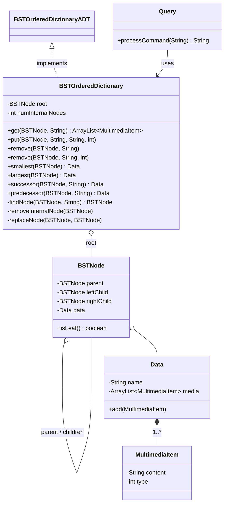

# Multimedia Ordered Dictionary

A Java ordered dictionary built on a hand-written **binary search tree**. Each key (a word) maps to a list of multimedia items (text, audio, image or HTML), and a command-line app supports lookups, ordered traversal, insertion and removal.

The project was built under one constraint: **every operation must work directly on the tree.** No query is answered by copying the nodes into an array or list and searching that. Lookups, neighbour queries and ordered traversal all come from the tree's shape and the BST ordering property.

```text
Enter next command: get flower
The word flower is not in the ordered dictionary.
Preceding word:  fireworks
Following word:  homework

Enter next command: next computer 2
computer course cube
```

---

## Contents
- [Quick start](#quick-start)
- [How it works](#how-it-works)
- [Data structures and algorithms](#data-structures-and-algorithms)
- [Object-oriented design](#object-oriented-design)
- [Java concepts in practice](#java-concepts-in-practice)
- [Known limitations](#known-limitations)
- [Roadmap](#roadmap)

---

## Quick start

```bash
./run.sh                         # loads data/sample-input.txt
./run.sh path/to/your-input.txt
```

| Command | What it does |
|---|---|
| `get k` | Shows every item stored under `k`. If `k` is missing, prints the nearest keys before and after it. |
| `add k c t` | Adds content `c` of type `t` (1 text, 2 audio, 3 image, 4 html) under key `k` |
| `remove k` | Removes key `k` and everything stored under it |
| `delete k t` | Removes only the items of type `t` under `k`; removes the key too if nothing is left |
| `next k d` | Prints `k` (if stored), then the `d` keys that follow it in sorted order |
| `prev k d` | Prints `k` (if stored), then the `d` keys that precede it, in reverse sorted order |
| `first` / `last` | Smallest / largest key |
| `size` | Number of keys stored |
| `end` | Quits |

**Input file format:** pairs of lines, a key followed by its content. The content's type is detected from its extension: `.wav`/`.mid` is audio, `.jpg`/`.gif` is an image, `.html` is a web page, and anything else is text.

```text
computer
An electronic machine frequently used by Computer Science students.
computer
data/computer.gif
```

---

## How it works

The sample input's 17 keys arrive in this order:

```text
course homework nap roar tree programming loon cute computer
spring exam matrix fireworks ohcanada cube dancing lightning
```

Inserted in that order, they build this tree (`L` and `R` mark the left and
right child; every child position not shown here holds an empty leaf node):

```text
course
├─L computer
└─R homework
   ├─L cute
   │  ├─L cube
   │  └─R exam
   │     ├─L dancing
   │     └─R fireworks
   └─R nap
      ├─L loon
      │  ├─L lightning
      │  └─R matrix
      └─R roar
         ├─L programming
         │  └─L ohcanada
         └─R tree
            └─L spring
```

17 internal nodes at height 6, and 18 empty leaves holding the positions
between them. `course` arrived first, so it is the root; `nap` sits deep on
the right because every key after it that is larger than `homework` had to
pass through it.

Each internal node stores a `Data` object, which pairs the key with a list of `MultimediaItem`s:



| Class | Responsibility |
|---|---|
| `MultimediaItem` | One piece of content plus its type. Immutable once created. |
| `Data` | A key together with all of its items |
| `BSTNode` | Tree structure only: parent and child links, plus a reference to its data |
| `BSTOrderedDictionary` | All of the tree algorithms, behind the `BSTOrderedDictionaryADT` interface |
| `Query` | The user-facing layer: reads the input file, parses commands and formats output |

---

## Data structures and algorithms

### The structure: a BST with leaf sentinels

A **binary search tree** keeps one rule at every node: keys in the left subtree are smaller, and keys in the right subtree are larger. Because of that rule, the tree can find a key by discarding half of what's left at each step.

This implementation adds a design choice: **every empty position is a real leaf node** rather than `null`. Only internal nodes hold data, and every internal node has exactly two children (a *proper* binary tree). An empty dictionary is a single leaf as the root.

Why bother? Because the leaf where a search ends is the exact spot where the key belongs.

- **Insertion is "fill the leaf in place."** No separate insertion pointer is needed, and inserting into an empty tree isn't a special case, because the root leaf simply becomes an internal node.
- **Every loop has the same stopping rule**, `while (!node.isLeaf())`, with no scattered `null` checks.

Inserting `course`, `homework` and `computer` gives the tree below, where `·`
is an empty leaf node rather than a `null` link:

```text
          course
         /      \
   computer      homework
    /    \        /    \
   ·      ·      ·      ·
```

### One search powers everything

`findNode` returns either the internal node holding the key, or the leaf where the key *would* go. `get`, `put` and both `remove`s are built on it:

```java
private BSTNode findNode(BSTNode r, String key) {
    BSTNode node = r;
    while (!node.isLeaf()) {
        int comparison = key.compareTo(node.getData().getName());
        if (comparison == 0)      return node;                  // found it
        else if (comparison < 0)  node = node.getLeftChild();   // go smaller
        else                      node = node.getRightChild();  // go larger
    }
    return node;  // the leaf where key belongs
}
```

```java
// put: if the key is new, turn the leaf into an internal node with two fresh leaves
if (node.isLeaf()) {
    node.setData(new Data(key));
    node.setLeftChild(new BSTNode(node, null, null, null));
    node.setRightChild(new BSTNode(node, null, null, null));
    numInternalNodes++;
}
node.getData().add(new MultimediaItem(content, type));
```

### Successor and predecessor, even for missing keys

The **successor** of a key is the smallest stored key larger than it. A common textbook version first finds the key, then either goes into the right subtree or climbs up through parents. That only works if the key exists.

Here, a single root-to-leaf walk handles both cases. Every time the search turns **left**, the current node is larger than the key, so it's the best successor candidate seen so far:

```java
while (!node.isLeaf()) {
    if (key.compareTo(node.getData().getName()) < 0) {
        candidate = node.getData();   // larger than key: best guess so far
        node = node.getLeftChild();   // look for something closer
    } else {
        node = node.getRightChild();
    }
}
return candidate;
```

This is what makes `get homework` work: `homework` isn't stored, but its neighbours `flower` and `matrix` still come back from one O(h) walk each. `next k d` then just calls `successor` d times.

### Removal: the three cases

Deleting from a BST has to keep the ordering rule intact:

| Case | What happens |
|---|---|
| Both children are leaves | The node is replaced by a leaf |
| One internal child | That child moves up into the node's place |
| Two internal children | The node takes the data of its **in-order successor** (the leftmost node of its right subtree), and the successor is unlinked instead. The successor has no left internal child, so unlinking it is always one of the easy cases above. |

The first two cases share one helper, `replaceNode`, which rewires the parent's link, or reassigns `root` if the removed node was the root.

### Complexity

h is the tree height and n the number of keys.

| Operation | Time | Extra space |
|---|---|---|
| `get`, `put`, `remove` | O(h) | O(1) |
| `smallest`, `largest` | O(h) | O(1) |
| `successor`, `predecessor` | O(h) | O(1) |
| `next k d` / `prev k d` | O(d · h) | O(1) |
| `remove(k, type)` | O(h + m), where m is the items under k | O(1) |

Every algorithm is **iterative**, not recursive, so a tall tree can't overflow the call stack.

How tall is h? For keys inserted in random order the expected height is O(log n), around 2–3x log₂ n in practice. For keys inserted **already sorted**, the tree degrades into a linked list and h = n. That's the motivation for the self-balancing AVL tree on the [roadmap](#roadmap).

---

## Object-oriented design

### Encapsulation
Every field in every class is `private`. Other classes reach state only through accessor methods, so, for example, `Query` never touches a tree pointer. Helper algorithms (`findNode`, `removeInternalNode`, `replaceNode`, `determineType`) are `private` too, which keeps each class's public surface down to what callers actually need.

### Programming to an interface
`BSTOrderedDictionary implements BSTOrderedDictionaryADT`. The interface is the contract (what an ordered dictionary can do), and the class is one way of fulfilling it. A different implementation, such as a balanced tree or a skip list, could replace it without changing callers. The v2 roadmap does exactly that with an AVL tree.

### Single responsibility and separation of concerns
Each class has one reason to change:
- Change how media is played → `Query` only.
- Change the tree algorithm → `BSTOrderedDictionary` only.
- `BSTNode` knows nothing about multimedia, and `MultimediaItem` knows nothing about trees.

The dictionary throws a `DictionaryException` when a key is missing, and **`Query` decides what message the user sees**. Keeping data-structure errors separate from user-facing wording is deliberate; mixing them is a common source of bugs.

### Composition over inheritance
The model is built by **composition**: a node *has* data, data *has* a list of items, the dictionary *has* a root. No inheritance hierarchy is involved because none is needed, and none of these is an "is-a" relationship.

### Abstraction layers
```text
Query (commands, I/O)  →  BSTOrderedDictionary (ordered-dictionary operations)  →  BSTNode (links)
```
Each layer works in its own vocabulary: commands at the top, keys and ordering in the middle, pointers at the bottom.

---

## Java concepts in practice

| Concept | Where |
|---|---|
| **Interfaces** | `BSTOrderedDictionary implements BSTOrderedDictionaryADT` |
| **Generics and collections** | `ArrayList<MultimediaItem>` for each key's items |
| **Constructor overloading** | `BSTNode()` for a leaf and `BSTNode(parent, left, right, data)` for a linked node |
| **Checked exceptions** | `remove` declares `throws DictionaryException`; `Query` catches it and also handles `MultimediaException` from the media players, so a missing file doesn't crash the program |
| **File I/O** | `BufferedReader` + `FileReader` read the input file line by line in the `Query` constructor |
| **String processing** | `StringTokenizer` splits commands, `toLowerCase()` makes keys case-insensitive, and `lastIndexOf('.')` plus `substring` detect file extensions |
| **`compareTo`** | Lexicographic ordering of keys, which drives every tree decision |
| **`switch`** | Dispatching each item to the right handler (print, play, show image, open page) |
| **`StringBuilder`** | Building multi-line output without creating a new `String` on every append |
| **`static` vs instance** | `processCommand` is `static` per the spec, so the dictionary is a `private static` field the static methods can reach |
| **Safe in-place list removal** | `remove(key, type)` loops **backwards** over the `ArrayList` so deleting an element doesn't shift unvisited indices |
| **Object references** | Removal works by rewiring references; the garbage collector reclaims unlinked nodes |

---

## Known limitations

These are known trade-offs, not hidden bugs:

- **Unbalanced tree.** Sorted input degrades operations to O(n).
- **`int` type codes.** Media types are the numbers 1–4 rather than an `enum`, so the compiler can't catch an invalid type.
- **`Data.getMedia()` returns the internal list.** Callers can modify it directly. The assignment's `remove(key, type)` relies on this, but a defensive copy or a dedicated method would be safer.
- **One large `processCommand`.** Adding a command means editing a long if/else chain.
- **No automated test suite yet.** Testing was manual, plus a course autograder (10/10).

Each of these maps to a phase of the roadmap.

---

## Roadmap

[`docs/PRD.md`](docs/PRD.md) plans v2 in six independently shippable phases:

1. **Engineering foundation:** Gradle multi-module build, GitHub Actions CI, linting and coverage
2. **Generic core and tests:** `OrderedDictionary<K, V>`, an O(1)-space in-order iterator, range queries, and property-based tests against `java.util.TreeMap`
3. **OOP redesign:** an `enum` for media types, sealed `record` types for media items, and the Command pattern for the CLI
4. **Algorithms:** an AVL tree and order-statistic queries (`rank`, `select`) behind the same interface
5. **Persistence and REST API:** JSON save/load and a Dockerized API
6. **Data:** JMH benchmarks on a ~100k-word dictionary, plus a notebook comparing BST, AVL and `TreeMap`

## Layout
| Path | Contents |
|---|---|
| `src/` | The five project classes |
| `support/` | Stand-in versions of the media players, input reader, exceptions and ADT interface, written so the project compiles and runs on its own. |
| `data/sample-input.txt` | The example dictionary shown above |
| `docs/PRD.md` | v2 roadmap |

## Origin
This started as an assignment for a Data Structures and Algorithms course at Western University. Tag `v1.0-assignment` marks the submitted version.

**Author:** Seon Sivasathan
